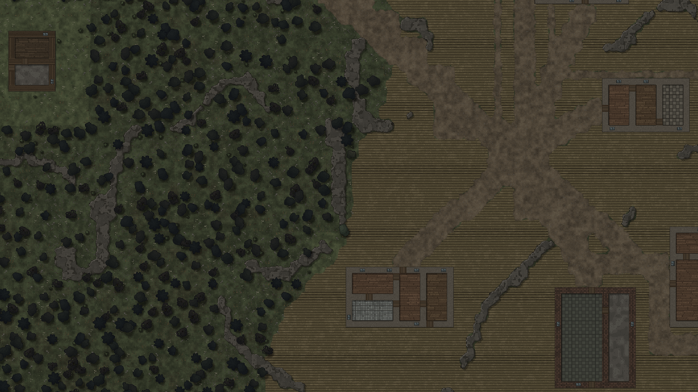
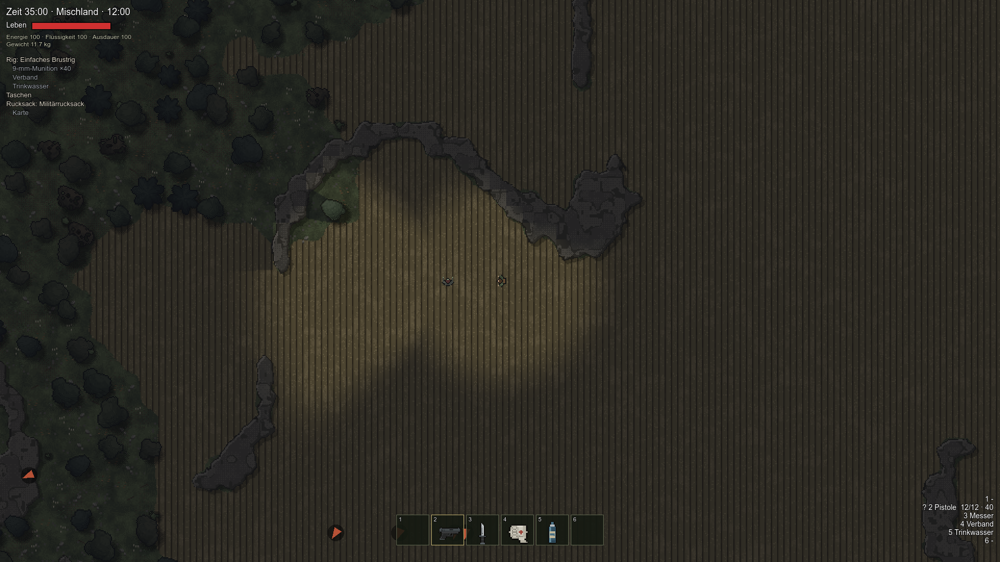
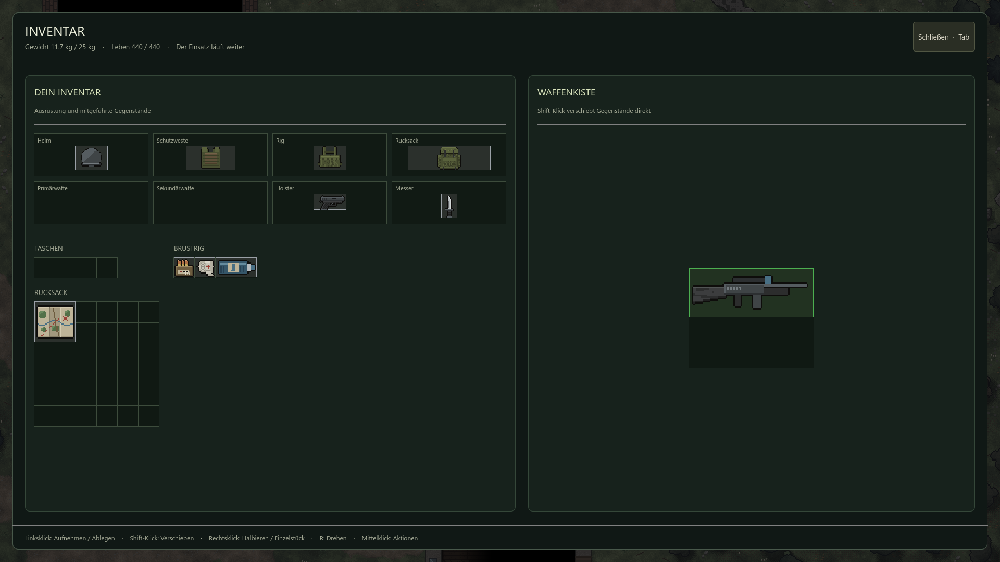

# 2D-Zombie-Extraction

In diesem 2D-Zombie-Spiel startest du einzelne Einsätze und suchst nach Waffen, Ausrüstung und anderer Beute. Das Spielprinzip ist von Escape from Tarkov inspiriert.

Vor einem Einsatz entscheidest du, welche Ausrüstung du mitnimmst. Unterwegs erkundest du zufällig erzeugte Landschaften mit Wäldern, Dörfern und Gebäuden und triffst auf Zombies.

Gesammelte Beute sicherst du, indem du einen Fluchtpunkt erreichst; bei einem verlorenen Einsatz geht die mitgeführte Ausrüstung verloren. Im Lager kannst du deine Ausrüstung für den nächsten Einsatz vorbereiten.

## Installation und Start

**[Windows-Paket herunterladen](https://github.com/LeNevio1337/2D-Zombie-Extraction/releases/latest/download/2D-Zombie-Extraction-Windows.zip)**

1. Die ZIP-Datei vollständig entpacken. Eine zusätzliche Installation ist nicht nötig.
2. `Start.cmd` doppelklicken. Das Spiel öffnet sich in einem eigenen Fenster.

## Einen Einsatz spielen

1. Im Lager Ausrüstung zusammenstellen und einen Einsatz starten.
2. Die Umgebung erkunden, Kisten öffnen und Beute ins Inventar verschieben.
3. Einen Fluchtpunkt erreichen, um die Beute zu sichern und ins Lager zurückzukehren.

### Steuerung

- `WASD/Umschalt`: bewegen/sprinten · Maus/Linksklick: zielen/angreifen.
- `E` halten: Kiste öffnen · `E`: Bodenbeute öffnen · `R`: nachladen.
- Im Inventar: Linksklick aufnehmen/ablegen · Shift-Klick verschieben · Rechtsklick halbieren/einzeln ablegen.
- `Tab`: Inventar · `M`: Karte · `Esc`: Pause.
