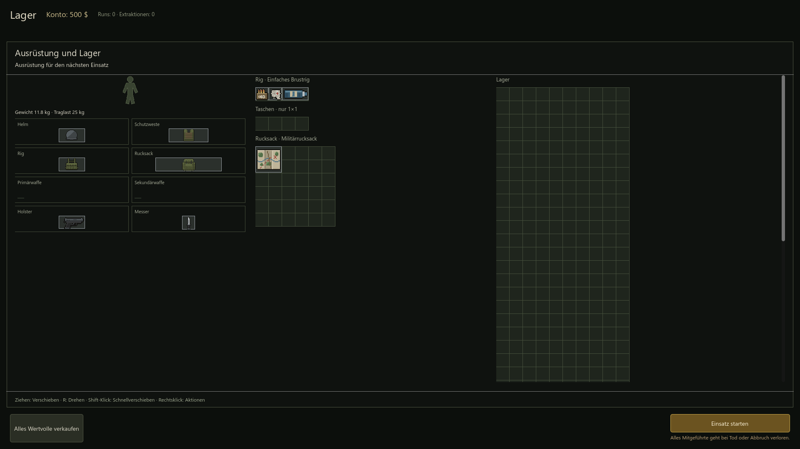
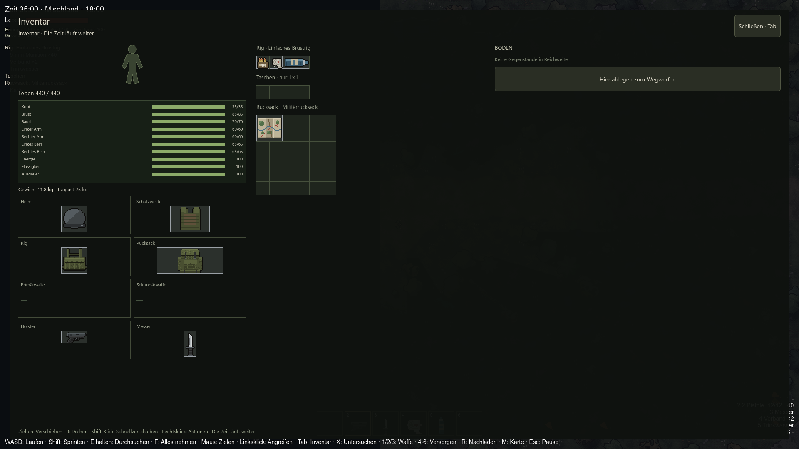
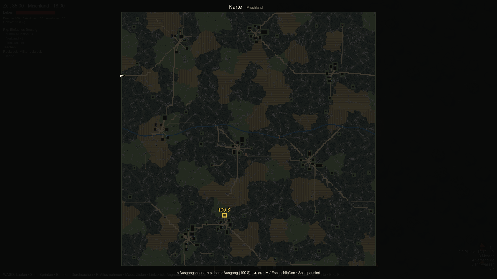

# 2D-Zombie-Extraction

2D-Zombiespiel mit einer Extraction-Mechanik, inspiriert durch Escape from Tarkov. Beute sammeln und am Fluchtpunkt sichern; bei einem verlorenen Einsatz geht die mitgeführte Ausrüstung verloren. Inventar und Lager verbinden die Einsätze. Code mit KI erstellt.

Inventar und Karte ansehen

**[Windows-Paket herunterladen](https://github.com/LeNevio1337/2D-Zombie-Extraction/releases/latest/download/2D-Zombie-Extraction-Windows.zip)**

## Installation für Windows

Paket vollständig entpacken. Keine zusätzliche Installation nötig.

## Start

`Start.cmd` doppelklicken und einen Einsatz starten.

## Bedienung

- `WASD/Umschalt`: bewegen/sprinten · Maus/Linksklick: zielen/angreifen.
- `E` halten: durchsuchen · `F`: Beute nehmen · `R`: nachladen.
- `Tab`: Inventar · `M`: Karte · `Esc`: Pause.
